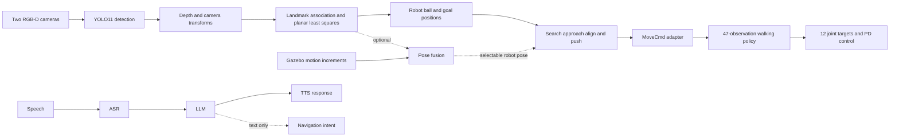

# G1 Humanoid Autonomy

**Jie Wu · Robotics system integration in ROS and Gazebo**

A project portfolio and curated implementation of humanoid autonomy: learned walking, RGB-D soccer perception, field localization, task-level ball interaction, and a speech interface prototype.

I worked through the training, deployment, and integration exercises on Unitree G1. This repository organizes those modules and makes their interfaces and assumptions explicit. It is based on Shenlan robotics course materials and upstream robotics software; it does not claim the underlying algorithms as original research.

## System architecture

The speech branch currently generates dialogue or navigation-intent text. A ROS navigation execution bridge is **not implemented in the supplied voice code**.

## Engineering highlights

- Five detection classes: ball, goalpost, and L/T/X field markings. Selected pixels and depth are transformed into the robot frame.
- Rule-based landmark association followed by planar least-squares estimation of x, y and yaw.
- A seven-state behavior selects a point 0.6 m behind the ball, approaches it, aligns, and pushes through walking contact.
- The walking policy receives 47 observations and produces 12 joint-position offsets; nominal policy and controller periods are 20 ms and 2 ms.
- An optional seven-component pose filter demonstrates visual correction and motion-increment fusion.
- LiDAR mapping, NDT initialization, FastGICP tracking, A* planning and local avoidance are documented as related navigation exercises.
- Speech interaction combines streaming ASR, streamed LLM responses and TTS with microphone gating during playback.

## Repository guide

| Directory | Purpose |
|---|---|
| `ros/soccer_robot` | Soccer perception, localization and behavior scripts |
| `voice` | Speech assistant reference with environment-based credentials |
| `perception` | YOLO training and prediction entry points |
| `reference` | Deployment excerpts and custom ROS message contracts |
| `docs` | Setup, technical decisions, evaluation and provenance |
| `tools` | Offline dataset overlap audit |

Start with [setup](docs/SETUP.md), [technical walkthrough](docs/ARCHITECTURE.md), and [evaluation boundaries](docs/EVALUATION.md).

## Release scope

This is a curated project release, **not a standalone simulator distribution**. Robot models, simulation plugins, policy/detector weights, original training datasets, and third-party dependency trees are not bundled. The ROS scripts require the matching external Unitree simulation workspace and custom messages. The locomotion excerpts are for interface review, not a complete C++ build target.

The reference soccer behavior caches the first ball and goal estimates; it is not continuous moving-ball tracking. Its completion condition is robot-to-goal distance, not a verified goal-line crossing. Optional fusion uses Gazebo model states as motion input. No success-rate or detector-accuracy claim is made without independent evaluation records.

## Attribution

See [THIRD_PARTY_NOTICES.md](THIRD_PARTY_NOTICES.md). Source attribution is independent of Git commit authorship. This repository begins a new release history maintained by Jie Wu; upstream histories are not imported.
